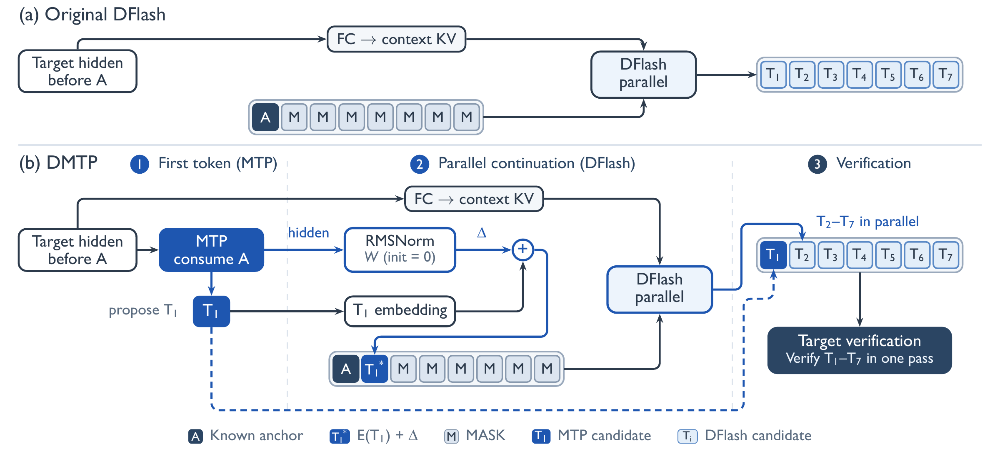

# DMTP: A Better First Token for Block Drafting via MTP

[](https://sylvan820.github.io/D-MTP/)
[](https://huggingface.co/Piggy12)
[](https://github.com/sgl-project/sglang/pull/50270)
[](https://github.com/sgl-project/SpecForge/pull/1189)

DMTP combines pretrained native MTP with parallel DFlash2 drafting. MTP proposes the first token; DFlash2 uses that proposal and its predictive representation to draft the remaining block in parallel. The target verifies the combined proposals.

This is a DMTP-enabled SGLang fork, supporting the dense FA3 path for Qwen3.6-27B and the HC/QSA path for Qwen3.8 Flash Next. Both paths are maintained on **`main`**.



## Method

1. **MTP first:** native MTP predicts the first candidate, T1.
2. **Parallel drafting:** DFlash2 receives `[A, T1, MASK x 6]`, where A is the last emitted token. A learned residual injects the MTP representation into the T1 embedding.
3. **Target verification:** DFlash2 proposes T2 through T7. The target verifies all seven proposals using token-level rejection sampling.

The original target-context path and A/MASK embeddings remain unchanged. The 27B checkpoint uses a low-rank hidden-state residual; the 120B checkpoint fuses separately normalized T1 embeddings and MTP hidden states inside its residual branch. The checkpoint configuration determines the adapter. The diagram shows the shared workflow; residual parameterization is checkpoint-specific.

See the [blog](https://sylvan820.github.io/D-MTP/) for motivation, ablations, and results. Inference performance is still being optimized.

## Models

| Draft | Target | Runtime |
| :--- | :--- | :--- |
| [Qwen3.6-27B-DMTP](https://huggingface.co/Piggy12/Qwen3.6-27B-DMTP) | [Qwen3.6-27B](https://huggingface.co/Qwen/Qwen3.6-27B) | Dense FA3 |
| [Qwen3.8-next-120b-dmtp](https://huggingface.co/Piggy12/Qwen3.8-next-120b-dmtp) | [Qwen3.8-Flash-Next](https://huggingface.co/Qwen/Qwen3.8-Flash-Next) | HC/QSA |

These repositories contain draft weights only. Matching target weights, native MTP, shared embeddings, and the language-model head are supplied separately. Use the target paired with the draft; the two launch configurations are not interchangeable.

## Installation

Use a Linux CUDA environment with enough GPU memory for the target, draft, and KV cache. Start from an SGLang-compatible environment with GPU kernels and dependencies matching this checkout; installing the Python package alone does not install every architecture-specific kernel.

```bash
git clone --depth 1 --branch main https://github.com/Sylvan820/sglang-dmtp.git
cd sglang-dmtp
python -m pip install -e ./python
python -m pip install -U huggingface_hub

# Confirm that Python imports this checkout rather than another SGLang install.
python -c 'import sglang; print(sglang.__file__)'
```

Stay in this environment for the following commands. If Hugging Face requests authentication or target-license acceptance, complete it for the chosen target before downloading:

```bash
hf auth login
```

## Inference

### Qwen3.6-27B: Dense FA3

Download the matching target and draft. The target download must include its native MTP weights; do not use a target-only export with MTP removed.

```bash
hf download Qwen/Qwen3.6-27B --local-dir ./models/Qwen3.6-27B
hf download Piggy12/Qwen3.6-27B-DMTP --local-dir ./models/Qwen3.6-27B-DMTP

TARGET_MODEL="$PWD/models/Qwen3.6-27B" \
DRAFT_MODEL="$PWD/models/Qwen3.6-27B-DMTP" \
TP_SIZE=8 CONTEXT_LENGTH=3072 PORT=39532 \
bash ./models/Qwen3.6-27B-DMTP/serve_dmtp.sh
```

The launcher selects FA3 with page size 1, BF16 weights, concurrency up to 32, and a 65,536-token KV budget. Decode CUDA Graphs are enabled; prefill stays eager and scheduling is serial. T1 sampling and conditioning run inside the MTP update graph, and candidate selection runs inside the DFlash graph.

### Qwen3.8 Flash Next 120B: HC/QSA

Use the same `main` checkout with its HC/QSA implementation. Download the unquantized target with native MTP and the corresponding draft:

```bash
hf download Qwen/Qwen3.8-Flash-Next --local-dir ./models/Qwen3.8-Flash-Next
hf download Piggy12/Qwen3.8-next-120b-dmtp --local-dir ./models/Qwen3.8-next-120b-dmtp

TARGET_MODEL="$PWD/models/Qwen3.8-Flash-Next" \
DRAFT_MODEL="$PWD/models/Qwen3.8-next-120b-dmtp" \
TP_SIZE=4 CONTEXT_LENGTH=65536 MAX_TOTAL_TOKENS=1048576 PORT=39532 \
bash ./models/Qwen3.8-next-120b-dmtp/serve_dmtp.sh
```

This launcher uses BF16, concurrency up to 32, paged KV with page size 64, decode CUDA Graphs, eager full-prompt prefill, and serial scheduling. Device-side commit, fused state reads, and packed graph inputs are enabled. Do not substitute the dense FA3 page-one configuration or an FP8 target. The general upstream PR does not include this architecture-specific QSA path.

### Verify the Server and Generate

Keep the server terminal running. In a second terminal, wait for readiness and send a request:

```bash
curl --fail http://127.0.0.1:39532/health

curl --fail http://127.0.0.1:39532/generate \
  -H 'Content-Type: application/json' \
  -d '{"text":"Write a Python binary search function.","sampling_params":{"temperature":1,"top_p":1,"top_k":-1,"max_new_tokens":256}}'
```

The response includes generated text and request metadata. Both launchers bind to `127.0.0.1:39532`; run one at a time or set different `PORT` values. For conversational workloads, use the matching target tokenizer's chat template.

### Configuration Notes

- **Proposal layout:** `--speculative-num-draft-tokens 8` is the runtime's eight-slot layout for seven proposals: one from MTP and six from DFlash. It does not request eight new candidate tokens.
- **Tensor parallelism:** set `TP_SIZE` for the available GPUs and a model-compatible partition. The examples are reference configurations, not a guarantee that every TP size has been validated.
- **Context and memory:** `CONTEXT_LENGTH` includes the prompt and generated tokens. Increase it only when GPU/KV capacity permits. The QSA launcher also accepts `MAX_TOTAL_TOKENS`; the dense launcher has its own fixed KV budget.
- **CUDA Graphs:** the launchers already enable the appropriate decode/MTP graph path. Prefill remains eager. Keep the architecture-specific flags together rather than mixing settings from the two scripts.
- **Startup failures:** check that `sglang.__file__` points to this checkout, the target includes MTP, the correct draft is selected, and the required attention/selector kernels are installed. For memory errors, reduce context or KV capacity to match the hardware.

Validate output correctness and performance on the exact hardware, checkpoint, and serving configuration before deployment.

## Upcoming Releases

We will also release DMTP checkpoints for smaller Qwen4 models in future updates.

## Implementation

- [DMTP worker](python/sglang/srt/speculative/dmtp_worker.py): shared entry point and dense drafting.
- [QSA worker](python/sglang/srt/speculative/dmtp_qsa_worker.py): HC features, native MTP state, QSA cache management, and guarded fast paths.
- [Regression tests and optimization flags](test/manual/dmtp/README.md).

The upstream PR contains the common DMTP path; architecture-specific QSA support is provided by this fork. Optional overlap and other fast paths have explicit guards. CPU regression coverage does not replace GPU correctness and performance validation of a deployed configuration.

## License

Runtime code retains SGLang's [Apache-2.0 license](LICENSE). DMTP draft weight licenses are provided in their model repositories. Qwen3.6-27B uses Apache-2.0; the separately supplied Qwen3.8-Flash-Next target and native MTP are governed by the Qwen Community License.

## Citation

```bibtex
@misc{shen2026dmtp,
  author = {Shen, Yuhao and Huang, Jianuo and Zhang, Yi and Yang, Xu and Yu, Hao and Wang, Xin and Li, Yucheng and Jiang, Huiqiang and Lin, Xi and Liu, Di and Zhang, Jun and Liu, Tianyu and Zheng, Bo and Liu, Dayiheng and Zhang, Jianwei and Wang, Cong},
  title  = {{DMTP}: A Better First Token for Block Drafting via MTP},
  year   = {2026},
  url    = {https://sylvan820.github.io/D-MTP/}
}
```

Built on [SGLang](https://github.com/sgl-project/sglang), [DFlash2](https://github.com/z-lab/dflash), and native Qwen MTP. Please also acknowledge the upstream projects when using them.
